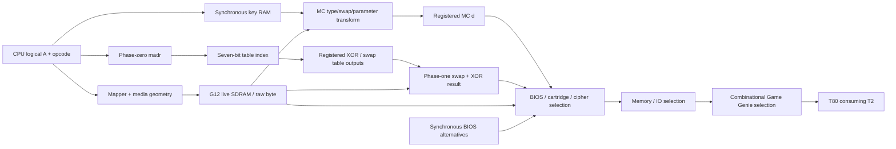

# Current G11 architecture and proof obligations

Baseline: cb2e8615128d61adb996ada68e6bbdcc314c20f6, tagged savestate v16.
The classifications below combine current-source dependencies with the completed
real-CPU and component timing evidence. See review.md and simulation_results.json
for the final closure gates.

## Path and selection

The T80 presents logical A[15:0], M1_n, MREQ_n and RD_n. The mapper and memory
decode translate that request to the physical ROM address. SMS.sv applies the
session's ROM-size/header mapping and its live SDRAM controller supplies
ram_dout. This is system.vhd's rom_do, the G12/G11 boundary. memory_bus.vhd
ultimately supplies the selected irom_D_out to T80's DI_Reg consumer at T2.
WRAM and BIOS selections can bypass cartridge decryption. The final IORQ
selection chooses memory_D_out versus IO data; Game Genie CODES then optionally
replaces that byte before GENIE_DI enters T80s. Both selections are
combinational, including the optional compare against the current decoded byte.

For enabled cartridge ROM, the current system.vhd selection priority is:

| encrypt | Selected decrypt path |
|---|---|
| 00 | Raw ROM, or combinational Janggun bit reversal when enabled |
| 01 | MC8123 for A15=0; raw above that range |
| 10 | SEGASYS1_DECT2 for A15=0; raw above that range |
| 11 | MC8123 for A15=0 OR A14=0; raw otherwise |

The CPU's C000-FFFF WRAM mapping takes precedence downstream. Encrypt is
download/session configuration from SYSMODE, not evolving guest history.
The top instantiates MC8123_rom_decrypt and SEGASYS1_DECT2 directly. It does
not instantiate SEGASYS1_PRGDEC or SEGASYS1_DECT1.

## Sequential inventory

| Stage / state | Width | Clock / reset / freeze behavior | Classification to establish |
|---|---:|---|---|
| T80 architectural image and restart context | 230 + tagged extension | CPU CE; DIRSet/restart restore | SERIALIZED (G01) |
| Mapper banks and detection history | Mapper-specific tagged fields | Guest CE, restore strobes | SERIALIZED (prior mapper proof) |
| Live SDRAM request/address/retained word and access phase | See G12 inventory | clk_sys; private reference uses ce_cpu | DETERMINISTICALLY RECONSTRUCTED (G12 boundary) |
| MC8123 key RAM contents | 8192 x 8 | Download writes; immutable during game | BOUNDARY-EXCLUDED session/media configuration |
| MC key RAM registered input address | 13 | clk_sys, no reset; continues during freeze | OVERWRITTEN BEFORE OBSERVATION (proven bounds) |
| MC8123 d | 8 | Every clk_sys; no CE/reset/freeze/restore | OVERWRITTEN BEFORE OBSERVATION (proven bounds) |
| MC function scratch v,s,t | 8+1+1 declared reg | Blocking assignments within functions; entry/input assignment precedes each use | Architecturally irrelevant scratch, no prior-call dependency |
| Sega2 XOR table contents | 128 x 8 | ROMCL download writes | BOUNDARY-EXCLUDED session/media configuration |
| Sega2 swap table contents | 128 x 8 | ROMCL download writes | BOUNDARY-EXCLUDED session/media configuration |
| Sega2 madr | 16 | clk_sys on phase=0; no reset/freeze/restore | OVERWRITTEN BEFORE OBSERVATION (proven bounds) |
| Sega2 phase | 1 | Toggles every clk_sys, initialized 0; no freeze/restore | ARCHITECTURALLY IRRELEVANT at legal consumers (both parities proven) |
| Sega2 xort.DO0 | 8 | Every clk_sys; no reset/freeze/restore | OVERWRITTEN BEFORE OBSERVATION (proven bounds) |
| Sega2 swpt.DO0 | 8 | Every clk_sys; no reset/freeze/restore | OVERWRITTEN BEFORE OBSERVATION (proven bounds) |
| Sega2 mrom_dt | 8 | clk_sys on phase=1; no reset/freeze/restore | OVERWRITTEN BEFORE OBSERVATION (proven bounds) |
| Inactive wrapper cnt0/cnt2 and DECT1 pipeline/tables | See SEGASYS1_PRGDEC.v | Not instantiated in current production path | BOUNDARY-EXCLUDED inactive hardware |

There is no separate active decrypt valid bit, request queue, previous raw-byte
register, previous output feedback, byte-position register or latched mode
selector. M1 history is included in Sega2 madr[15]; MC key selection uses the
current M1 input and the synchronous key RAM address stage. ROM word/byte
selection occurs upstream and belongs to the explicit G12 raw oracle.

Only seven madr bits enter the selected Sega2 table index; the other nine
bits feed only rad, which is unconnected in production. They are
architecturally irrelevant. Only swpt.DO0[4:0] reaches bswp; its upper three
bits are also irrelevant. The full physical inventory remains 41 pipeline
bits, without claiming all 41 are independent future-relevant history.

The immediately surrounding controller inventory is retained in
../savestate_g12_sdram_fix/state_inventory.md: q4, old_ref1, old_rd1,
latched a23/bank2, ram_req1, wr1, retained sd_dat16, rd_rdy1, download data8
and we_ack1, mode2, reset counter5/init_old1, registered SDRAM address13/bank2,
four command bits and DQ drive16. Its current no-download session and private
reference/reissue preconditions are checked at the raw boundary here. The
upstream T80 DI_Reg8 and replay stage2, divider5 plus registered enables,
phase_snap2/capture_tick1 and current host Pause/edge-history registers are
covered by the G01/G10/G12 restart contracts; none is silently reclassified as
a decrypt output register.

Additional surrounding, fixed-session state:

| Owner | Physical state / behavior | Treatment |
|---|---|---|
| SMS.sv SYSMODE | Two active encrypt bits in downloaded8-bit mode register; clk_sys ioctl writes | BOUNDARY-EXCLUDED fixed session configuration |
| SMS.sv ROM geometry | cart_mask24, cart_mask51224, cart_sz5121, session ROM-size/mode flags; download-derived | BOUNDARY-EXCLUDED fixed media geometry; final address transform is combinational |
| Internal boot ROM | sprom14-bit synchronous address stage,16KB immutable mboot.mif | DETERMINISTICALLY RECONSTRUCTED within one read-clock edge after address stability |
| External BIOS | spram18-bit synchronous address stage,256KB downloaded immutable bytes | Same one-stage overwrite rule; banking/address selection is combinational from restored mapper |
| External GG BIOS | spram14-bit synchronous address stage,16KB downloaded immutable bytes | Same one-stage overwrite rule |
| BIOS selection | Current host loaded/selection flags and serialized boot/media-control policy | Fixed session inputs plus existing serialized guest controls |
| Game Genie CODES | 32x34-bit configured codes, index6, code_change1; clk_sys, reset on ROM/code load, continues during freeze | BOUNDARY-EXCLUDED current host cheat configuration/input edge tracking; no per-read pipeline state |
| Game Genie outputs | Override1 and replacement8, combinational from code list/address/current selected byte | No omitted historical result; identical base-byte observation and fixed code list imply identical CPU input |

The BIOS read outputs are alternative mux inputs, not stages through which an
encrypted byte passes. None has a CPU-CE or freeze gate. Restored address and
mapper/media selection precede the private consuming T2 by more than the
single required read edge. The spram timing is also exercised by the real-key
RAM tests; sprom uses the same UNREGISTERED-output, clock-enabled-input memory
structure in ROM mode. No separate historical BIOS result is needed. BIOS
execution/cheat editing is not claimed as an additional integrated encrypted
CPU test: these surrounding paths are closed by their explicit source
dependencies and the unchanged fixed-session contract.

Downloads, changing keys/tables/mode/ROM geometry, choosing a different BIOS or
editing cheats across the comparison are different external/session inputs.
The proof holds the media/configuration fixed; it does not assert cross-media
compatibility merely because a32-bit game signature happens to agree.

## Exact dependencies



MC8123 key_a = {~opcode,A15:10,A8,A6,A4,A2:0}. The real synchronous key RAM
returns key_d; key=~key_d. The combinational type/swap/parameter expressions
select one of seven pure transforms of current raw prog_d. Every clk_sys
registers that result in d. There is no data feedback from the preceding byte.
The fixture's forward/inverse tables exhaust all 256 keys, both opcode states
and 256 raw bytes through the actual production module. This supplies a
functional oracle, not independent external validation of the cipher algorithm.

The exact selector expressions, with k=~key_d and op=opcode, are:

```text
type  = {k4^k5, k0^k1^k2^k4, k0^k2^~op}
swap  = {k2^k3, k0^k1}
param = {k1^k6^k7, k0^k1^k6, k0^k2^k3, k0^~op}
```

Types0/1 select type_0;2/3 select type_1a/1b;4/5 select type_2a/2b;
6/7 select type_3a/3b. Each is a pure byte transform with those parameters.
Thus opcode affects both which key is read and the transform itself.

Sega2 phase=0 captures madr={opcode,A14:0}. The index is
{madr14,madr12,madr9,madr6,madr3,madr0,~madr15}. Both DLROM tables register
their outputs each clk_sys. On phase=1 the output becomes
bswp(swpt.DO0,current raw rdt) XOR xort.DO0. The 24 swap values permute the
four even bit positions; values outside 0..23 yield zero. Previous raw or
decrypted bytes do not enter this expression. Phase determines *when* the
current byte is recomputed; whether this timing can affect a restored T2 is
the central dynamic obligation.

Mapper state affects physical raw data, while decryption indices use logical
CPU address. Matching physical ROM bytes alone is therefore insufficient:
the oracle must also match logical A and opcode/M1 at consumption.

## Capture/restart ordering to validate

Both decrypt pipelines continue clocking throughout SAVE and LOAD transport;
transport duration may change phase parity. Frozen settling alone is not a
proof: DIRSet can introduce a different logical address/M1 and private T1
changes the raw input again. Evidence must show the synchronous key/table
stages and registered output converge after the last relevant input change,
before historical/private or native consuming T2. A paused image with
suppressed historical consumption is a distinct ordering case.

The G12 post-fix oracle is tests/savestate_g12_sdram_fix/g11_input_oracle.md.
Every apparent decrypt mismatch must first pass CPU-address, physical-address,
raw-byte and request/response checks. A mismatch before that boundary is
contradictory G12 evidence, not a G11 witness.
